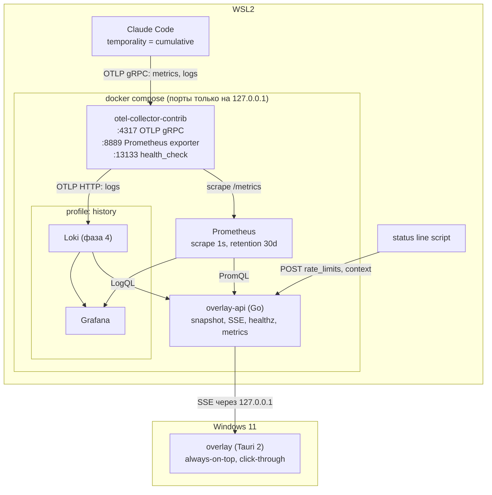

# Архитектура cc-overlay

Статус: дизайн фазы 0. Решения обоснованы в [ADR](adr/), запросы — в [queries.md](queries.md).

## Схема



Стрелка между коллектором и Prometheus показывает направление данных; соединение инициирует Prometheus.

## Компоненты

| Компонент | Роль | Порт (127.0.0.1) | Фаза |
|---|---|---|---|
| otel-collector-contrib | приём OTLP, удаление идентификаторов, отдача метрик в формате Prometheus, пересылка логов | 4317, 13133; внутри сети compose: 8889 (экспорт), 8888 (свои метрики), 4319 (запасной delta-вход) | 1 |
| Prometheus | хранение метрик 30 дней, PromQL | 9090 | 1 |
| Grafana | история и дашборды, provisioning как код | 3000 | 1 (профиль `history`) |
| overlay-api | считает показатели, отдаёт снимок и поток | 8787 | 2 |
| status line script | передаёт в overlay-api лимиты подписки и заполнение контекста | — | 2–3 |
| overlay | окно поверх всех окон | — | 3 |
| Loki | хранение событий | 3100 | 4 (профиль `history`) |

Номера портов предварительные, окончательно задаются в `.env.example`.

## Конвейеры коллектора

```
metrics: otlp → memory_limiter → transform/drop_ids → batch → prometheus
logs:    otlp → memory_limiter → transform/drop_ids → batch → otlphttp/loki
```

- `memory_limiter` стоит первым: он должен отказать во входе раньше, чем данные попадут в остальные процессоры.
- В основном конвейере нет `delta_to_cumulative`: Claude Code шлёт cumulative ([ADR-0001](adr/0001-temporality.md)). Процессор стоит только в запасном конвейере `metrics/delta` на внутреннем порту 4319.
- Внутренняя сеть compose имеет явно заданную подсеть (`CC_OVERLAY_SUBNET`): при активном VPN Docker не может выбрать её сам.
- У экспортёра `prometheus` включён `send_timestamps` и увеличен `metric_expiration` ([ADR-0002](adr/0002-metrics-path.md)).

## Бюджет задержки

Требование ТЗ — не больше 2 секунд от экспорта до экрана.

| Этап | Худший случай |
|---|---|
| Коллектор: `batch` | 0,2 с |
| Ожидание scrape (интервал 1 с) | 1,0 с |
| Ожидание опроса overlay-api (интервал 1 с) | 1,0 с |
| SSE и отрисовка | 0,05 с |
| **Итого** | **≈ 2,25 с**, в среднем ≈ 1,2 с |

Запаса нет. Если в фазе 3 измерение покажет превышение, опрос overlay-api сокращается до 500 мс. Интервал экспорта самого Claude Code (5 с) в бюджет не входит: ТЗ считает задержку от момента экспорта.

## Бюджет памяти

Цель ТЗ — около 500 МБ на весь стек. Каждому сервису задаётся `mem_limit`.

| Сервис | Лимит | Всегда запущен |
|---|---|---|
| otel-collector-contrib | 128 МБ | да |
| Prometheus | 160 МБ | да |
| overlay-api | 32 МБ | да |
| Grafana | 160 МБ | профиль `history` |
| Loki | 160 МБ | профиль `history` |

Постоянно работает ядро на 320 МБ. С профилем `history` выходит 640 МБ по лимитам.

Измерено в фазе 1 в простое: коллектор 40 МБ, Prometheus 32 МБ. Лимиты в `compose.yaml` сейчас: коллектор 160 МБ, Prometheus 160 МБ, Grafana 200 МБ; ужимаются после измерений под нагрузкой.

## Состояния оверлея

ТЗ запрещает показывать нули вместо отсутствия данных, поэтому overlay-api отдаёт статус явно, а каждое числовое поле может быть `null`.

| Статус | Условие | Что видит пользователь |
|---|---|---|
| `ok` | есть живая сессия, последняя точка моложе 2 интервалов экспорта | числа |
| `idle` | живых сессий нет, но за сегодня данные есть | итоги за день, блок сессии погашен |
| `stale` | у живой сессии последняя точка старше 2 интервалов экспорта | числа с пометкой «устарело» и возрастом |
| `no_data` | в Prometheus нет серий Claude Code за период | «нет данных» |
| `backend_down` | overlay-api не достучался до Prometheus | «бэкенд недоступен» |
| (локально в оверлее) | оверлей не достучался до overlay-api | «бэкенд недоступен» |

Различие между `idle` и `stale` возможно только при cumulative-экспорте: живой процесс шлёт точки каждый интервал, даже когда пользователь молчит. При delta молчащая сессия неотличима от умершей.

Дополнительный флаг `approximate` выставляется, когда страж `resets()` обнаружил сброс счётчика внутри окна ([ADR-0007](adr/0007-totals-semantics.md)).

## Сеть между WSL и Windows

Оверлей обращается к `http://127.0.0.1:8787`, а не к `localhost`: имя `localhost` в Windows может разрешиться в `::1`, который WSL не пробрасывает.

Docker Engine внутри WSL публикует порты на `127.0.0.1` самой WSL. В режиме NAT Windows пробрасывает свой localhost в WSL; в фазе 1 это подтверждено командой `curl.exe http://127.0.0.1:9090/-/ready` со стороны Windows. Если проброс перестанет работать, запасной вариант — `networkingMode=mirrored` в `.wslconfig`; это глобальная настройка, применяется только с согласия владельца.

## Приватность

Содержимое промптов, ответов и аргументов инструментов не собирается: шесть переменных `OTEL_LOG_*` остаются выключенными. Пять идентификаторов пользователя удаляются в коллекторе до записи куда-либо ([ADR-0008](adr/0008-privacy.md)).
